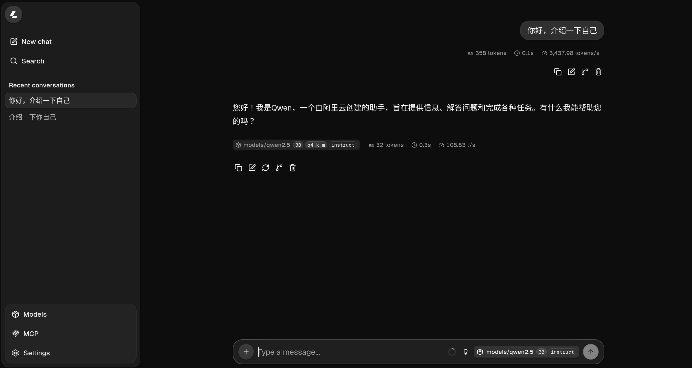
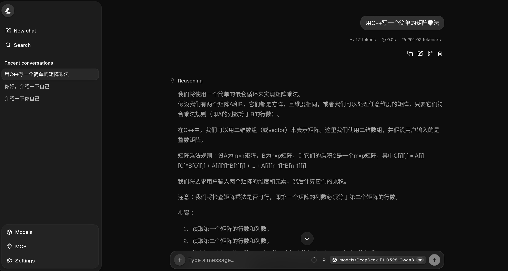

# 0 环境配置、编译和本地模型部署尝试
我的环境是Archlinux + 4060 8G laptop
## 编译
根据llama.cpp文档中的指令进行编译, 开启CUDA
```bash
cmake -B build -DGGML_CUDA=ON
cmake --build build --config Release
```

## 下载模型
从huggingface上下载了qwen2.5-3b-instruct-q4_k_m 和 DeepSeek-R1-0528-Qwen3-8B-Q4_K_M 模型, 放进models里  
一个3B的模型和一个8B小模型，8B差不多是我这台机器能部署的最大参数了

## 本地部署尝试
使用编译产物/build/bin/llama-server 加载3B模型并启动服务端  
用文档内的命令以及AI推荐添加的参数运行
```bash
./build/bin/llama-server -m models/qwen2.5-3b-instruct-q4_k_m.gguf \
          -ngl 99 -c 4096
```
-m      指定模型路径  
-ngl 99 能够将模型层全部卸载到显卡内运行(本质是让指定卸载的层数大于模型自身的总层数使得全部放入GPU)  
-c 4096 设定模型上下文窗口大小  
启动后有web前端地址，进行个简单的对话  


接下来再部署8B的Deepseek-R1-0528-Qwen3, 有Deepseek的深度思考能力
```bash
./build/bin/llama-server -m models/DeepSeek-R1-0528-Qwen3-8B-Q4_K_M.gguf \
  -ngl 99 \
  -c 16384 \
  -fa 1 \
  -ctk q8_0 -ctv q8_0 \
  --jinja \
  --reasoning-format deepseek \
  --temp 0.6 --top-p 0.95
```
这次多了几个新的启动参数:  
-fa 1                         开启 Flash Attention 融合算子，能大幅降低长上下文时的峰值显存占用  
-ctk q8_0  -ctv q8_0          量化KV Cache中的Key缓存和Value缓存为Q8_0，压缩显存占用，对推理精度几乎无影响  
--jinja                       强制llama-server使用模型文件自带的Jinja2对话模板，这样对话中不会出现重复的思考块  
--reasoning-format deepseek   告诉llama-server的响应解释器按照deepseek的规范分离模型的思考过程，不让思考过程出现在回复的正文里

