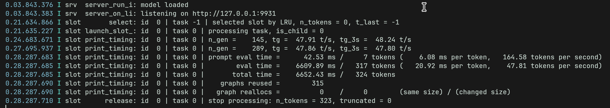
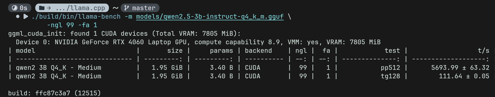

# 1 标准性能测试
在终端内用llama-server启动服务并对话后，终端内会有关于本次对话的性能指标  

这里有两个指标，prompt eval time(提示词评估时间) 和 eval time(生成评估时间)  
第一个prompt eval time是提示词处理(Prefill)的速度  
第二个eval time 是token生成(Decode)的速度，每生成一个新token都要把模型权重从显存读一遍  
在预处理阶段，模型将输入的token打包成一个二维矩阵，送入GPU做并行运算，速度极快，计算出所有token的key和value填入显存的KV Cache中。然后生成第一个token，这一阶段决定首字延迟

在生成阶段，模型读取KV Cache并根据第一个token继续生成第二个，并继续根据第二个token生成第三个。。。以此类推直至生成完毕，期间由于KV Cache总token增加（生成的新token会进入KV Cache使张量维度改变）计算图还要频繁重建。但主要速度瓶颈在于GPU从显存搬运模型参数到计算单元上这一步，由显存带宽决定。这一阶段决定模型的吐字速度，这个体感十分明显

## 使用 llama-bench 进行性能对照实验
这里使用llama.cpp自带的 llama-bench 测试工具进行性能对照实验  
分别测试模型在 纯GPU推理/CPU+GPU混合推理、开启或关闭Flash Attension时两个阶段的速率  

以qwen2.5-3B模型做测试
```bash
./build/bin/llama-bench -m models/qwen2.5-3b-instruct-q4_k_m.gguf \
    -ngl 99 -fa 1
```
qwen2.5-3b模型中主要有36层，-ngl设置成99就能纯GPU推理，设置成18即把其中18层放到GPU上，剩下的仍然在CPU中，实现混合推理  

可以看到有两个指标，pp512(Prompt eval/Prefill) 和 tg128(Text Gen/Decode)，分别对应预处理阶段处理512个token 和 生成阶段生成128个token   
以下是测试结果:  
| 启动配置 | pp512(tok/s) | tg128(tok/s) |
| ---- | ---- | ---- |
| 纯GPU + Flash Attention | 5731.94 $\pm$ 52.38 | 111.70 $\pm$ 0.06 |
| 混合 + Flash Attention | 2975.07 $\pm$ 81.28 | 41.83 $\pm$ 1.15 |
| 纯GPU | 5033.19 $\pm$ 48.01 | 106.52 $\pm$ 0.08 |
| 混合 | 2799.48 $\pm$ 92.03 | 42.39 $\pm$ 0.56 |

## 显存、带宽实验
模型由此换成 `DeepSeek-R1-0528-Qwen3-8B-Q4_K_M.gguf` 与前面的 `qwen2.5-3b-instruct-q4_k_m.gguf` 进行对比：  

| 模型 | 模型大小 | tg128(tok/s) |
| ---- | ---- | ---- |
| qwen2.5-3b-instruct-q4_k_m | 2GB | 111.7 |
| DeepSeek-R1-0528-Qwen3-8B-Q4_K_M | 4.7GB | 49.93 |

可以看到，模型大小相差 2.35 倍，生成速度相差 2.24 倍，两者几乎成反比，印证了 Decode 阶段的性能瓶颈主要在于显存带宽。  

## KV Cache量化省显存实验
测试开启 KV Cache 量化(添加-ctk, -ctv参数)前后的显存占用变化：  
```bash
./build/bin/llama-server -m /home/ksndjaks/AI-infra/models/DeepSeek-R1-0528-Qwen3-8B-Q4_K_M.gguf \
  -ngl 99 -fa 1 -c 16384 -ctk q8_0 -ctv q8_0
```
然后使用nvidia-smi观察显存占用  
| KV Cache 精度 | 显存占用 |
| ---- | ---- |
| 默认 FP16 | 7GB |
| 开启 Q8 | 5GB |
